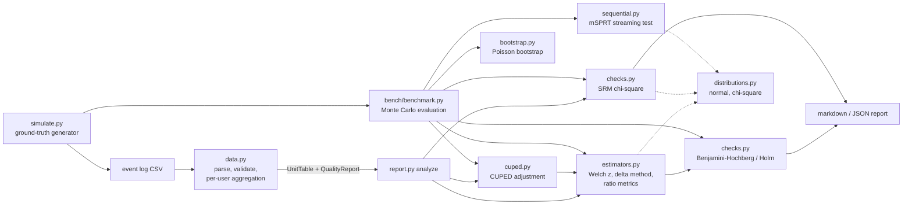

# abtest-analysis-kit

`abkit` is a Python library and command-line tool for analysing A/B test
(online controlled experiment) data. It takes a raw event log, cleans it and
aggregates it to one row per user. It then runs the statistical checks an
analyst would run before believing a result:

- **Data validation**: it counts malformed rows, events from users who were never assigned, events logged under the wrong variant, and users assigned to more than one variant (these users are excluded).
- **Sample ratio mismatch (SRM)**: a chi-square goodness-of-fit test on arm sizes, so broken randomisation or logging is caught before anyone reads the metrics.
- **Fixed-horizon tests**: Welch z-tests for difference in means. Relative lift and its CI come from the delta method.
- **Ratio metrics** (e.g. revenue per session): delta-method variance at the user level, because the analysis unit (user) is not the denominator unit (session).
- **CUPED**: variance reduction that uses each user's pre-experiment value of the same metric as a covariate.
- **Poisson bootstrap**: percentile CIs, generated in memory-bounded chunks.
- **Sequential testing**: mSPRT always-valid p-values, so a test can be checked every day without inflating false positives.
- **Multiple-testing corrections**: Benjamini-Hochberg (FDR) and Holm (FWER) across all metric × variant comparisons.

The only dependency is numpy. The normal and chi-square distribution functions
are implemented in `abkit/distributions.py`.

## Running it

```bash
python -m venv .venv && . .venv/bin/activate
pip install -e ".[test]"

# generate a synthetic event log with a planted +10% conversion effect and 1% junk rows
abkit simulate events.csv --users 50000 --lift treatment=1.1 --dirty 0.01 --seed 7

# analyse it
abkit analyze events.csv --control control --ratio revenue/sessions --ratio orders/sessions
abkit analyze events.csv --control control --json      # machine-readable output

pytest -q                          # tests
python bench/benchmark.py          # full benchmark (~45 s here)
python bench/benchmark.py --quick  # smaller version used in CI
```

Output of the `analyze` command above:

```
Users per variant: control=24939, treatment=25061
Sample ratio check: p=0.5853 (ok)
Data quality issues: malformed_rows=167, unassigned_user_rows=167, variant_mismatch_rows=166

| variant | metric | control | treatment | lift | lift 95% CI | p | q (BH) | CUPED var. red. |
|---|---|---|---|---|---|---|---|---|
| treatment | orders | 0.2363 | 0.2658 | +11.90% | [+6.92%, +16.88%] | 7.28e-07 | 3.64e-06 | 36.5% |
| treatment | revenue | 6.272 | 7.2 | +13.96% | [+7.42%, +20.49%] | 8.385e-06 | 2.096e-05 | 27.5% |
| treatment | sessions | 2.971 | 3.005 | +0.56% | [-0.73%, +1.85%] | 0.391 | 0.391 | 36.1% |
| treatment | revenue/sessions | 2.111 | 2.396 | +13.51% | [+6.08%, +20.94%] | 0.000155 | 0.0001937 | - |
| treatment | orders/sessions | 0.07955 | 0.08848 | +11.23% | [+5.28%, +17.17%] | 9.692e-05 | 0.0001615 | - |
```

`analyze` exits with status 2 when the SRM check fails, so it can gate a pipeline.

### Input format

The input is a long-format CSV with the columns `user_id,variant,period,metric,value`:

| period | meaning |
|---|---|
| `assign` | user was assigned to `variant` (metric/value empty) |
| `pre` | metric event from before the experiment, used as the CUPED covariate |
| `post` | metric event during the experiment |

Every assigned user counts in the denominator, even with zero events.

## Architecture



| module | role |
|---|---|
| `abkit/data.py` | Streams the CSV. Pass 1 resolves assignments and finds conflicts; pass 2 accumulates per-user sums with `np.add.at` for each (period, metric). |
| `abkit/estimators.py` | Difference in means, delta-method relative lift, ratio metrics, sample-size formula. |
| `abkit/cuped.py` | θ = Cov(X,Y)/Var(X), estimated on the pooled arms so both arms get the same adjustment. |
| `abkit/bootstrap.py` | Poisson(1) weight matrices × data, processed in chunks capped at 32 MB. |
| `abkit/sequential.py` | Streaming running sums per arm and the mSPRT likelihood ratio with a normal mixing prior. |
| `abkit/checks.py` | SRM test, BH and Holm adjusted p-values. |
| `abkit/simulate.py` | Users with heterogeneous activity (Gamma), conversion propensity (Beta) and spend (LogNormal), with pre and post periods correlated through those user traits. |
| `abkit/report.py`, `abkit/cli.py` | Ties everything together. |

## Benchmark results

The benchmark simulates thousands of experiments where the true effect is
known. It measures false positive rate, power, CI coverage and variance
reduction, and then times the full pipeline. Rates are shown with 95% Wilson
intervals so you can see the Monte Carlo noise.

Command: `python bench/benchmark.py` (seed 2026, Python 3.12.14, numpy 2.5.4,
macOS arm64). Raw output is in `bench/results.json` and `bench/results.md`.

### Fixed-horizon test, 40000 users, 1000 simulated experiments

| metric | A/A false positive rate (raw) | A/A FPR (CUPED) | power at +10% conversion (raw) | power (CUPED) |
|---|---|---|---|---|
| orders | 6.4% (5.0%-8.1%) | 5.6% (4.3%-7.2%) | 83.0% (80.5%-85.2%) | 95.9% (94.5%-97.0%) |
| revenue | 5.1% (3.9%-6.6%) | 5.6% (4.3%-7.2%) | 65.9% (62.9%-68.8%) | 80.7% (78.1%-83.0%) |

Mean CUPED variance reduction (pre-period covariate): sessions 36.0%, orders 36.0%, revenue 27.1%

### Peeking: 20 interim looks, 500 users/arm per look, 2000 simulations

| truth | naive z-test, stop at first p<0.05 | mSPRT always-valid p | single test at the end | mSPRT mean stopping look |
|---|---|---|---|---|
| null | 26.1% (24.2%-28.1%) | 1.1% (0.7%-1.6%) | 5.0% (4.1%-6.0%) | - |
| effect_0.05sd | 97.0% (96.2%-97.7%) | 73.9% (71.9%-75.8%) | 94.8% (93.7%-95.7%) | 11.3 |

### 95% CI coverage for relative revenue lift (A/A, 2000 users, 500 simulations)

| method | coverage | mean CI width |
|---|---|---|
| delta method | 94.6% (92.3%-96.3%) | 71.0% |
| Poisson bootstrap (1000 replicates) | 95.6% (93.4%-97.1%) | 72.7% |

### Sample ratio mismatch check (200000 users, p < 0.001, 5000 simulations)

- flagged when split is truly 50/50: 0.1% (0.1%-0.3%)
- flagged when split is 50.5/49.5: 87.8% (86.8%-88.7%)

### Multiple metrics: 20 metrics, 4 with a real effect, 1000 simulations

| correction | false discovery rate | P(any false positive) | power |
|---|---|---|---|
| none | 17.9% | 55.5% (52.4%-58.6%) | 76.8% |
| Benjamini-Hochberg | 4.0% | 11.9% (10.0%-14.1%) | 48.1% |
| Holm | 2.5% | 5.2% (4.0%-6.8%) | 37.5% |

### Pipeline throughput (200000 users, 1596943 event rows, 54.3 MB CSV, best of 3)

- CSV parse + validation + per-user aggregation: 1.26 s (1,269,320 rows/s)
- analysis of 5 metrics (CUPED, ratios, BH): 19.5 ms

### What the numbers say

- Checking a normal z-test at 20 looks and stopping at the first p < 0.05 gave a false positive in 26.1% of A/A tests. The mSPRT p-value kept this at 1.1%. The cost is power: 73.9% against 94.8% for a single test at the planned end. On average the mSPRT stopped at look 11.3 of 20.
- Using the pre-period value as a covariate cut variance by 27–36% here. That raised power on orders from 83.0% to 95.9% with the same sample size. These reductions come from the simulator's assumptions (see Limitations). On real data they depend on how well pre-period behaviour predicts post-period behaviour.
- With 20 metrics and no correction, 55.5% of experiments had at least one false positive. BH kept the false discovery rate at 4.0%.

## Limitations

- All tests use the normal approximation. On sparse, skewed metrics with small samples this is only approximately right. For example, the A/A false positive rate for raw `orders` came out at 6.4% (Wilson interval 5.0–8.1%), slightly above the nominal 5%. There is no exact or t-based small-sample test.
- The benchmark data comes from `abkit/simulate.py`, not from a real product. CUPED variance reduction and power depend heavily on the simulated user heterogeneity.
- mSPRT uses the variance estimated at each look, plugged in as if it were known. The mixing variance `tau2` has to be chosen by the user, and the results depend on that choice.
- The CSV loader is single-threaded pure Python and holds all events in memory. It processed about 1.27 M rows/s here, which is fine for millions of rows but not for billions. At that scale the aggregation step belongs in a SQL or Spark job, with this library run on the per-user table.
- There are no heterogeneous-treatment-effect, segment or novelty-effect analyses, and no support for cluster-randomised experiments beyond user-level ratio metrics.
